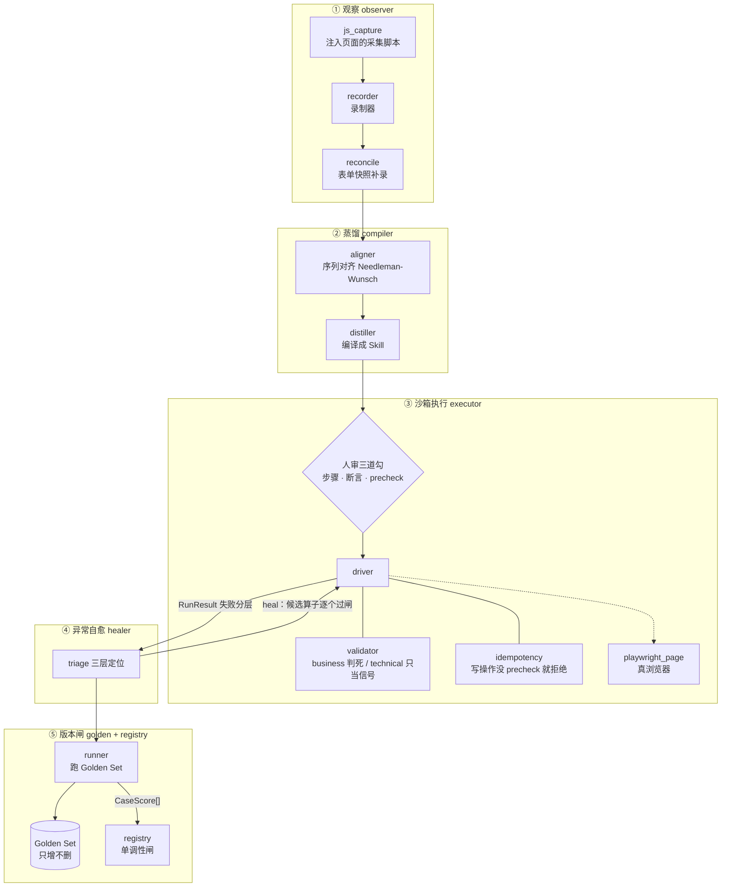
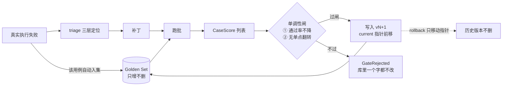

# SkillForge

[](https://github.com/nvndfvx/skillforge/actions/workflows/ci.yml)
[](https://github.com/nvndfvx/skillforge/releases/latest)
[](pyproject.toml)

**看着人干一遍 → 蒸馏成一个技能 → 沙箱执行 → 坏了自己修 → 越用越准。**

观察人类操作 → 蒸馏参数化技能 → 沙箱执行 → 异常自愈。

这不是"录制回放"。它把两遍演示**对齐**出变量（而不是让 LLM 猜），
把断言**锚在业务单号**上（而不是"提交成功"这句话），
再用一个**回归基准集 + 单调性闸**保证版本只升不降。

> 设计定稿（含 7 条实现期硬约束、两个天花板）：[docs/design-v3.md](docs/design-v3.md)
> 详细安装与上手指南（含 Windows 踩坑）：[docs/usage.md](docs/usage.md)

---

## 它能做什么

一个具体场景：

> 你每天要在公司 ERP 后台录 30 张报销单。以前手点 30 遍，页面一改版脚本就废。
> 现在：**你亲手录 2 遍**（故意换客户名、金额）→ SkillForge 对齐出"哪些是变量、哪些是固定步骤"
> → 人审确认"这五步对不对、成功证据是哪个单号" → 之后它自己跑，跑坏了先自愈，修不了才找人。

### ① 从操作里长出技能（不写代码、不录坐标）

| 能力 | 怎么做的 |
|---|---|
| 识别变量 | **两遍演示序列对齐**（Needleman–Wunsch），差异就是变量，不让 LLM 猜 |
| 定位元素 | **元素指纹**（role + 可访问名 + 相邻文案 + 相对位置），id/class 改了还能重新认出来 |
| 抓漏掉的字段 | 每个动作后扫一遍表单，把不触发 `change` 的字段（日期控件/组件库写值）补录回来 |
| 生成成功判据 | 从"提交前后新出现的标识符"里自动发现业务单号，做断言 |

### ② 执行时有安全闸

- **幂等门**：写操作没有 precheck（"怎么查这单已存在"）→ **直接拒绝执行**，不赌"可能已经成功了"
- **写操作必须唯一命中**：`提交` 不会误点到 `撤销提交`（role+name 是子串匹配，这是真踩过的坑）
- **断言分级**：业务断言（单号存在）判生死；技术断言（URL 变了）只报信，不判技能死

### ③ 坏了自己修，修完过闸才收

```
执行失败 → 三层定级（参数错 / 定位失效 / 断言不过）
        → 封闭算子集里挑一个改 → 跑回归基准集 → 过闸才收，没过闸库里一个字都不改
```

`swap_locator` / `add_wait` / `drop_optional_step` 三个算子可自动；关弹窗、改参数、补查重必须人来。

### ④ 越用越准，有据可查

- **回归基准集只增不删**，每条来自演示、自愈过的失败、或人工补充
- **单调性闸**：① 通过率不降 ② 无单点翻转。没有它，自愈就是"用一个 bug 换另一个 bug"
- **版本可回滚**，历史不删，来回切
- **探针告警**：技术断言连续失败 N 次 → 升格成"要人看一眼"的事件（静默退化是最危险的）

外加一个**批量执行**模式（`skillforge batch`）：一次跑一批单据，
**单条失败不中断整批**，支持断点续跑和节流。

> 这是"每天真的干活"和"跑测试"的本质区别：跑测试要的是"哪条挂了"，
> 干活要的是"剩下的先做完，挂的那几张下班再补"。

## 两个执行域：浏览器 / CLI

同一套技能结构、同一套断言、同一套回归闸，跑在两种地方：

| | `domain: "browser"` | `domain: "cli"` |
|---|---|---|
| 动作 | `goto` / `fill` / `click` … | 只有 `run`（一条命令模板） |
| 读到的文本 | 页面 DOM | 进程 `stdout + stderr` |
| 写操作查重 | `precheck` 断言（找元素） | `precheck_command`（跑命令，返回 0 表示已存在） |
| 录制 | `skillforge record` | 手写（命令没有「录两遍」这回事） |
| 跑法 | `skillforge run`（自动分派） | 同一条 `skillforge run` |

```bash
# 示例在 examples/cli-skill.example.json
skillforge run --skill cli-skill.json --params '{"目标":"https://example.com"}'
```

CLI 域沿用**同一条幂等门**：写步骤没有 `precheck_command` 就 `blocked`、拒绝执行。
所以「越用越准」那一整套（基准集 / 单调性闸 / 自动补丁）在 CLI 域同样成立。

**为什么不做桌面 GUI** —— 这是个决定，不是没做完：

- 控件树比 DOM 脆一个数量级：换个版本、换个 DPI、换个输入法就可能定位不到
- 桌面自动化能拿到的**业务证据很弱**：截图像素、窗口标题，都不像单号那样能当判据
- 这个项目的地基是「稳定地把事做对」，桌面域做不到；硬做只会多一个会骗人的域

真要桌面自动化，正确做法是先找那软件的 API 或命令行（多数企业软件都有），
包成 CLI 域 —— 而不是在上面套一层截图点击。

## 它不做什么

别把它当万能药，这几条是真的边界：

- ❌ **不做桌面 GUI 机器人**：只支持浏览器域和 CLI 域（理由见上一节）
- ❌ **不替你判断业务规则变了**：规则变了，它会把这个错的流程**做得又快又稳**（见[设计文档 §6](docs/design-v3.md)）
- ❌ **不适合低频流程**：月频的活半年攒不够失败样本，"越用越准"学不动
- ❌ **不适合 ≥1000 次/天**：那时候该直接反解 API，而不是开浏览器点
- ❌ **不承诺全自动**：人审三道勾是必需的一道闸，不是可选项

## 安装

**要求**：Python ≥ 3.10，零运行时依赖（真浏览器功能才需要 playwright）

### 方式一：只想看看 / 跑测试（什么都不用装）

```bash
git clone https://github.com/nvndfvx/skillforge.git
cd skillforge
python tests/run_all.py          # 167 个测试（16 个 CLI 域测试需要允许创建子进程）
python examples/demo_loop.py     # 端到端闭环演示（不用浏览器）
```

### 方式二：当成命令行工具用

```bash
pip install -e .                          # 从源码装（开发；分发名 skillforge-engine）
# 或
pip install git+https://github.com/nvndfvx/skillforge.git

skillforge --help
```

装完就有一个 `skillforge` 命令，14 个子命令见下面「命令行」。

### 方式三：要真的控制浏览器（录制 / 真跑 / 自动修）

```bash
pip install "skillforge-engine[browser]"
playwright install chromium        # 约 130MB
```

或者用仓库自带脚本 —— **装进 `vendor/`，不写系统目录，并且复用系统已装的 Chrome**：

```bash
python scripts/bootstrap_playwright.py
```

### 方式四：直接下现成的 wheel（不用 git，不用 pip install git+…）

每个版本都会打包成 wheel 挂到 [Releases](https://github.com/nvndfvx/skillforge/releases)：

```bash
# 从 Releases 页面下载 skillforge-<版本>-py3-none-any.whl 后
pip install skillforge_engine-0.6.1-py3-none-any.whl
```

也可以让 pip 直接吃 URL：

```bash
pip install "https://github.com/nvndfvx/skillforge/releases/latest/download/skillforge_engine-0.6.1-py3-none-any.whl"
```

> 这个 wheel 是 CI 里**真装进干净 venv、再用装进去的包跑完整套 167 个测试**之后才发布的。

### 验证装好了

```bash
skillforge --help                              # 命令能出来
python tests/run_all.py                        # 167 个测试
python tests/test_real_browser.py              # 真浏览器 27 项（没装 playwright 会 SKIP）
```

### Windows 注意

两个真踩过的坑，都写进 [docs/usage.md](docs/usage.md) 了：

1. **控制台不是 UTF-8**（cp1252/cp936）→ 测试脚本已自带 UTF-8 切换，但你自己的脚本打印中文可能崩
2. **git 不走系统代理** → `git push` 报 `Could not resolve host` 时，给仓库单独配代理：
   ```powershell
   git config http.proxy http://127.0.0.1:7890
   ```

## 5 分钟跑通一个例子

不需要浏览器，用内置的假页面演示完整闭环：

```bash
# 1. 跑离线测试，确认环境 OK
python tests/run_all.py

# 2. 完整闭环：两遍演示 → 对齐 → 编译 → 人审 → Golden → 改版失败 → 修复 → 过闸 → 回滚
python examples/demo_loop.py

# 3. 自动打补丁 + 回归基准集扩到 10 条
python examples/demo_heal.py
```

真实项目里的用法（把文件换成你自己的）：

```bash
# 两遍演示轨迹 → Skill 草稿
skillforge compile --trace-a a.json --trace-b b.json --out skill.json --skill-id expense

# 交互式人审（三道勾逐条确认，别背参数）
skillforge review --skill skill.json -i

# 建回归基准集（只增不删）
skillforge golden add --store ./store --skill-id expense --case-id c1 --params '{"客户名称":"张三"}'

# 真浏览器跑批 → 过闸发布
skillforge run-golden --store ./store --skill skill.json --start-url "file:///..." --out scores.json
skillforge release --store ./store --skill skill.json --scores scores.json
```

## 状态

| | |
|---|---|
| 离线测试 | **167 个**，零第三方依赖（16 个 CLI 域测试要允许创建子进程，沙箱里会自动 SKIP） |
| 真浏览器检查 | **27 项**，真 Chrome 上跑通（`tests/test_real_browser.py`） |
| CI | ubuntu + windows × Python 3.10/3.12，全绿 |
| 打包 | wheel + sdist；CI 会装进干净 venv，**用装进去的包**再跑一遍全套测试 |
| 版本 | 0.6.1（`skillforge/__init__.py` 单一来源，打 tag 自动发 Release） |
| 闭环 | 录制 → 对齐 → 编译 → 人审三道勾 → 基准集跑批 → 过闸发布 → 自动打补丁 → 回滚 |
| 还缺 | 并行分支与条件跳转（编排现在只有串行） |

变更历史见 [CHANGELOG.md](CHANGELOG.md)。

## 命令行

14 个子命令，覆盖闭环每一步。完整教程见 [docs/usage.md](docs/usage.md)。

```bash
# 1. 录演示：打开浏览器，你操作一遍，录成 Trace.json（要 playwright）
python -m skillforge record --url "https://your-erp/new" --out demos/a.json --skill-id expense
#    再录一遍，**故意换参数**（客户名/金额），否则变量会被判成常量

# 2. 两遍轨迹 → Skill 草稿
python -m skillforge compile --trace-a demos/a.json --trace-b demos/b.json \
    --out skill.json --skill-id expense --name 报销单录入

# 3. 人审三道勾：两种方式选一个
python -m skillforge review --skill skill.json -i          # 逐条交互（终端）
python -m skillforge review --skill skill.json --serve     # 本地网页：可删步骤/上下移/改值

# 4. 建回归基准集（只增不删）
python -m skillforge golden add --store ./store --skill-id expense \
    --case-id c1 --params '{"客户名称":"张三","金额":"500"}'

# 4b. 用例太少？从参数定义生成候选（必须人确认，不是"自动获得真值"）
python -m skillforge golden suggest --store ./store --skill-id expense \
    --skill skill.json --limit 12          # 确认后加 --apply 才落盘

# 5. 真浏览器跑批 → scores.json
python -m skillforge run-golden --store ./store --skill skill.json \
    --start-url "file:///path/to/form.html" --out scores.json

# 6. 过闸发布（没过闸库里不会有任何改动）
python -m skillforge release --store ./store --skill skill.json --scores scores.json

# 7. 回滚 / 看状态
python -m skillforge rollback --store ./store --skill-id expense
python -m skillforge status   --store ./store --skill-id expense

# 8. 失败 → 自动打补丁 → 过闸发布（需要真浏览器）
python -m skillforge heal --store ./store --skill skill.json \
    --start-url "file:///path/to/form.html"          # 加 --dry-run 只试不落库

# 8b. 看 technical 探针的连续失败（H14：只喊，不改技能）
python -m skillforge signals --store ./store --skill-id expense
python -m skillforge signals --store ./store --skill-id expense --reset   # 人工确认后清零

# 9. 批量干活：一次跑一批单据，失败隔离 + 断点续跑（需要真浏览器）
python -m skillforge batch --store ./store --skill skill.json \
    --cases cases.json --out report.json --resume --interval-ms 800
#    cases.json: [{"item_id":"s1","params":{"客户名称":"张三","金额":"500"}}, ...]

# 10. 灰度发布：新版本先接 10% 真实请求，样本够了再 promote
python -m skillforge canary start --store ./store --skill-id expense \
    --candidate skill-v1.1.json --weight 0.1 --min-samples 20
#    按用户分群而不是按单据：
#    --mode param --field 客户编号       同一用户永远同一版本
#    --mode segment --field 租户 --segments A公司,B公司   只放行白名单（100%）
python -m skillforge batch --store ./store --skill skill.json \
    --cases cases.json --out report.json --canary        # 按分群粘性分流
python -m skillforge canary status --store ./store --skill-id expense
python -m skillforge canary promote --store ./store --skill-id expense --scores scores.json
python -m skillforge canary abort  --store ./store --skill-id expense

# 11. 多技能编排：上一步的产出当下一步的入参
python -m skillforge flow validate --flow flow.json --store ./store   # 静态校验，不用浏览器
python -m skillforge flow run      --flow flow.json --store ./store --out flow-report.json
```

## 架构

两张图：**模块之间怎么串**，以及**为什么它不会越修越坏**。

### 数据流：五个引擎与四个契约



四个贯穿全程的数据契约，全都能落盘（`schema/serde.py`）：

| 契约 | 由谁产出 | 里面有啥 |
|---|---|---|
| `RawTrace` | recorder | 动作序列 + 元素指纹 + 操作前后页面摘要 + 表单快照 |
| `AlignmentReport` | aligner | 变量、不稳定定位器、未对齐步骤、预警 |
| `Skill` | distiller | 参数、前置条件、步骤、断言、幂等键、状态机 |
| `RunResult` / `CaseScore` | driver / runner | 每步状态、失败分层、逐条用例通过与否 |

### 版本闭环：失败怎么变成资产



**没有"单调性闸"，自愈就只是"用一个 bug 换另一个 bug"。** 所以：

- 没过闸 → 库里一个字都不改（`GateRejected`，测试里逐字节比对过）
- 过了闸 → 写入新版本，`current` 指针移动
- 回滚 = 移动指针，历史版本不删，可以来回切

注意图里那条 `失败 → Golden Set` 的边：**失败不是事故，是新增的训练样本**。
这是"纵向调优"和"带重试的脚本"的分界线。

## 跑起来（开发）

```powershell
# 离线测试（不需要浏览器、不需要装任何东西）
python tests\run_all.py

# 端到端闭环演示（编译→人审→Golden→改版→修复→过闸）
python examples\demo_loop.py

# 真实浏览器验证（需要 vendor/playwright + 系统已装的 Chrome）
python scripts\bootstrap_playwright.py
python tests\test_real_browser.py     # 22/22 checks
```

> 真浏览器测试在 DSH 沙箱里会 SKIP：Windows 的 asyncio 子进程走命名管道，
> 会被沙箱拒绝（`WinError 5`）。这不是代码问题，请在普通终端里跑。

录制与真浏览器执行需要 playwright：

```powershell
pip install -r requirements.txt
# 或用自带脚本装进 vendor/（不写 C 盘用户目录）
python scripts\bootstrap_playwright.py
```

---

## 目录

```
skillforge/
├── schema/
│   ├── types.py     枚举 / Locator / ElementFingerprint / ActionTuple / RawAction / RawTrace
│   ├── models.py    Assertion / Step / Skill / GoldenCase / 单调性闸 / 实体候选抽取
│   └── serde.py     JSON 反序列化（持久化用）
├── observer/
│   ├── js_capture.py  注入页面的采集脚本（多 frame、before/after 分离、指纹、表单快照）
│   ├── recorder.py    Playwright 录制器 + 写副作用推断
│   ├── reconcile.py   表单快照差集补录（H4：程序赋值字段）
│   └── aligner.py     序列对齐（Needleman–Wunsch）+ 变量/不稳定/分支分类
├── compiler/
│   └── distiller.py   对齐报告 → Skill 草稿（变量→参数、动作→步骤、回执→业务断言）
├── executor/
│   ├── adapter.py     PageAdapter 协议（executor 不依赖 playwright）
│   ├── validator.py   断言求值（business 判死 / technical 只当信号）
│   ├── idempotency.py 幂等门（写操作没 precheck → 拒绝执行）
│   ├── candidates.py  从失败页面按指纹收集新定位器候选
│   ├── driver.py      执行 + 前置条件 + 指纹兜底 + 写操作唯一性 + 失败分层
│   └── playwright_page.py  真实浏览器适配器（只有这层依赖 playwright）
├── healer/
│   ├── triage.py      三层定位 + 封闭算子集
│   └── patcher.py     自动打补丁：改一版 → 跑闸 → 被拒 / 被收
├── golden/
│   ├── runner.py      Golden 跑批 + 单调性闸接线
│   └── suggest.py     从参数生成候选用例（origin=manual_edge，需人确认）
├── registry.py        版本库：发布闸（GateRejected）、回滚、Golden Set 只增不删
├── batch.py           批量执行：失败隔离 + 断点续跑 + 节流
├── canary.py          灰度：粘性分桶路由 + 按版本统计 + promote/abort 判定
├── webui.py           人审网页（纯标准库 http.server，只绑 127.0.0.1）
├── signals.py         technical 探针的连续失败累积告警（H14，只喊不改）
├── cli.py             命令行（record/compile/review/golden/run-golden/release/
│                      rollback/status/canary/batch/heal/signals 共 12 个）
├── testing.py         FakePage（tests 与 examples 共用）
├── scripts/
│   └── bootstrap_playwright.py  把 playwright 装进 vendor/（绕开 pip 临时目录问题）
├── examples/
│   ├── demo_compile.py  两遍演示 → Skill 草稿
│   ├── demo_loop.py     完整闭环（编译 → 人审 → Golden → 改版 → 修复 → 过闸）
│   └── demo_heal.py     自动打补丁 + Golden Set 扩到 10 条
├── docs/
│   ├── usage.md       安装 / 上手 / Windows 踩坑 / FAQ
│   └── design-v3.md   设计定稿（7 条硬约束、两个天花板、MVP 验收 14 条）
├── push.cmd           双击推送（Windows）
└── tests/
    ├── fixtures/      真实浏览器用的三个页面（v1 / v2 文案改版 / v3 id 改版）
    ├── run_all.py     一次跑完所有离线测试
    ├── test_aligner.py
    ├── test_compiler.py
    ├── test_executor.py
    ├── test_js_capture.py
    ├── test_registry.py
    ├── test_healer.py
    ├── test_signals.py
    ├── test_batch.py
    ├── test_canary.py
    ├── test_webui.py
    ├── test_cli.py
    └── test_real_browser.py
```

**零第三方依赖**：除 `executor/playwright_page.py` 与 `observer/recorder.py`（鸭子类型，导入期不依赖），
其余全是纯 stdlib，所以能离线跑、能离线测。
pydantic 留作后续可选校验层——先让数据结构和算法站住，再加校验。

---

## 五件地基在代码里的落点

| 地基 | 落点 | 可执行检查 |
|---|---|---|
| ① 断言分级 business/technical | `Assertion.kind` | `errors()`：business 锚 ui_text 直接报错 |
| ② 元素指纹 | `ElementFingerprint` + `similarity()` | 录制期采集，编译期判不稳定 |
| ③ 序列对齐 | `observer/aligner.py` | `warnings`：无变量 / 变量重名 / 长度差异 |
| ④ 幂等 | `Step.write_effect` + `idempotency_key` + `precheck` | `Step.errors()`：写操作缺键或缺 precheck 报错 |
| ⑤ 锚业务单号 | `Assertion.anchor` + `extract_entity_candidates()` | `errors()`：business 必须锚实体 |

---

## 本轮「写代码才逼出来」的 8 个洞

聊设计聊不出来的，一写就露。按严重度排：

### H1｜两次演示不换参数 → 静默产出「常量技能」🔴

两次演示如果参数一样，对齐会判定「没有变量」，编译出一个所有入参硬编码的技能。
**它编译期不报错，第一次换客户就崩。** 这是静默失败，最危险的一类。

- 现状：`_post_checks` 里已加硬预警。
- 真修法在流程：录制前给**演示指南**（"第二遍请务必换客户名 / 金额 / 日期"），
  并在对齐后把"变量数"当作录制质量指标——**0 个变量 = 重录**。

### H2｜快照时机与操作间隔的竞态 🟡

`after_text` 是在 settle 之后取的。如果用户两次操作间隔小于 settle 窗口，
第一个动作的 `after_text` 里会混进第二个动作的结果 → 断言基于错误状态生成。

- 现状：`meta.settle_races` 计数 + 编译期检查「相邻动作 after_text 完全相同」并预警。
- 残留：settle 只能近似，录制时人最好**慢一点**。

### H3｜iframe 身份丢失（未修）🟡

指纹里只有 `frame_url`。同一个 URL 可以挂多个 frame，业务系统大量用 iframe。
一旦指纹撞车，locator 失效后按指纹重匹配会匹配到**另一个 frame 里的元素**。

- 修法：指纹加 `frame_path`（frame 层级索引链），候选收集按 frame 分组。

### H4｜程序赋值的字段录不到（未修）🟡

日期选择器、自动完成、部分组件库是**用 JS 直接写 value**，不触发 `change` 事件。
这类字段会整个漏录 → 技能少一步 → 一跑就错。

- 修法：提交前跑一次「表单全字段快照」，和录制到的动作做差集，差集就是漏录的字段。

### H5｜不稳定判定只看 selector（**我这版写错了，已改**）🟠

最初 `_targetdiff` 只比较 selector，同时存在三个问题：

- 录制期故意不生成 selector → 永远判不出不稳定（地基③ 的一半价值直接归零）；
- selector 相同、指纹不同 = 元素被换了 → 漏判；
- selector 不同、指纹相同 = 只是 id 变了 → 误报。

改为**指纹相似度优先，selector 只作辅助**（阈值 0.80）。

### H6｜写副作用靠按钮文案猜（**已改保守默认**）🟠

`infer_write_effect` 用文案匹配。判不出来时原本返回 `NONE`——这是**危险方向**：
误判成读 = 不做幂等 = 重复提交事故。

已加 `WriteEffect.UNKNOWN`，判不出来时按写操作对待。原则记下来：

> **默认值的方向决定安全性。** 误判成"更严格"只是麻烦；误判成"更宽松"是事故。

### H7｜schema 缺生命周期状态（**已补**）🟠

`Skill.errors()` 要求"有人确认过的 business 断言"，但编译产物天然全是 `llm_proposed`。
用同一套严格校验，**草稿根本存不下来**——v3 状态机画了 `HUMAN_REVIEW` 却没有字段承载它。

已加 `Skill.state`（draft → reviewed → published）并拆出 `publish_blockers()`：
`errors()` 只管结构，`publish_blockers()` 才是发布闸。

### H8｜「两次一致」不等于「正确」（最深的一个，代码修不了）🔴

对齐只能证明两遍**一样**，不能证明两遍**对**。
如果人在两遍里都点错了同一个按钮，对齐会说"这就是标准流程"，照单编译。
更糟的是：Golden Set 的三条也来自这批演示——**同一个盲区贯穿到底**。

> 这不是 bug，是"从观察学习"这件事的天花板：**观察里没有对错信号，只有一致性。**

- 唯一防线：人审不能只审断言，**必须审步骤顺序**（"这五步是不是你要的流程"）。
- MVP 验收里要加一条：人必须对着步骤清单打勾，才能进 `reviewed`。

---

## 第二轮（M1.5）：采集洞 + compiler 逼出来的新洞

第一轮列的 H3 / H4 已修，修的过程中又冒出四个：

### H9｜快照补录会误伤「联动填充」🔴

选客户 → 地址被自动填。这个地址**不是用户填的，是系统算出来的**。
但从"表单快照差集"看不出区别，于是它被补录成 fill 步骤 → 还被参数化。
技能一跑就会往一个本该自动计算的字段里打字，轻则被拒，重则破坏联动。

- 现状：补录的动作打 `source="snapshot_diff"`，并进 `meta.snapshot_diff_steps` 等人工判定。
- **但步骤仍然会被编译成 fill** —— 这是当前最需要你拍的一个取舍：
  - 编成 `fill`：照录制回放，人审时要逐条删掉不该填的
  - 编成 `assert`/`wait`：不主动填，只在人审确认后才升级成 fill（**更安全，我倾向这个**）

### H10｜单号正则钉死位数 → 明年变成假阴性（**我这版写错了，已改**）🟠

`R-20240115` 被我泛化成 `R-\d{8}`。单号位数随年份增长 → 明年 `R-202501234`（9 位）
会验证失败 → Healer 去修一个**其实没坏**的技能。

改为**下界**：`R-\d{6,}`。宁可宽一点，也不要造假的失败信号。

### H11｜编译器永远生成不出 `precheck` → 流程缺一道勾 🔴

写操作硬约束要求「幂等键 + precheck」，但 precheck 是「怎么查这张单是否已存在」——
**这是业务知识，编译器不可能知道**。所以每个写步骤必然带一个 error，草稿永远过不了 `publish_blockers()`。

这说明 v3 的人审**少了一道勾**：

> 现有两道勾：① 步骤顺序 ② 断言。**必须加第三道：③ 补 precheck（写操作的查重查询）。**

否则 MVP 第 12 条（幂等验证）根本跑不起来——不是代码没写完，是流程里没有这一步。

### H12｜`goto` 步骤和 `precondition` 重复（小）🟢

录制第一步的 goto 会编译成 step 1，同时起始 URL 又进了 `preconditions`。
执行时等于"先跳到 A，再跳到 A"。无害但冗余，二期可以用扰动探测删掉。

---

## 第三轮（M2）：executor + healer + golden —— 闭环转通一圈

已落地（58 个测试全过 + 端到端 demo）：

| 模块 | 干什么 |
|---|---|
| `executor/adapter.py` | PageAdapter 协议：执行逻辑不依赖 playwright，所以能离线测 |
| `executor/validator.py` | 断言求值：business 失败判死，technical 失败只记信号 |
| `executor/idempotency.py` | **幂等门**：写操作没 precheck → 直接拒绝执行（不是"放行然后赌"） |
| `executor/driver.py` | 执行 + 指纹兜底 + 失败分层（param / locator / assertion / precheck） |
| `healer/triage.py` | 三层定位 + 封闭算子集（6 个算子，带代价与"能否自动"） |
| `golden/runner.py` | Golden 跑批 + 单调性闸接线 |

### 闭环实测（`demo_loop.py` 的真实输出）

| 阶段 | 结果 |
|---|---|
| 编译 | `draft`，**4 条发布阻断** |
| 人审三道勾 | 阻断清零 → 可发布 v1.0 |
| Golden 跑 v1.0 | 3/3，rate=1.0 |
| 页面改版 | step 4 `locator_not_found` → 定级 **env** → 候选算子 `swap_locator / dismiss_dialog / add_wait` |
| 修定位器 → v1.1 | 3/3 → 闸 **通过** |
| 故意改坏 → v1.2 | 0/3 → 闸 **拒绝**（单点翻转 ×3 + 通过率 1.0→0.0）|

**这是第一次把「观察 → 蒸馏 → 执行 → 自愈 → 过闸」整圈跑通。**

### 这轮修掉的错

- **H9 联动填充**：不再参数化，改编成 `READ_ENTITY` 只读校验（不主动回填）
- **H10 单号正则**：精确位数 → 下界 `R\-\d{6,}`，避免单号变长造成假失败
- **H11 缺第三道勾**：`review_checklist()` 三道勾，`publish_blockers()` 卡住未打勾的技能
- **goto 没地方存 URL**：schema 缺口，改为 `goto` 用 `value` 携带 URL，不要求 locator

### 新发现的洞

#### H13｜3 条 Golden Set 的闸太粗，基本是"全有全无" 🔴

3 条用例里 1 条就是 33 个百分点。通过率只能取 `0 / 0.33 / 0.67 / 1.0`，
单调性闸几乎没有分辨率——一个补丁修好一条、弄坏另一条，闸只能靠"单点翻转"拦住，
而"通过率"这个指标在样本这么小的时候**根本说明不了趋势**。

- **建议**：MVP 跑通后立刻把 Golden Set 扩到 **≥10 条**（含 healed_failure 与 manual_edge），
  否则"越用越准"在数字上无法被观测。

#### H14｜technical 失败没有累积告警 🟡

`technical_assertion` 失败只记在单次 `StepResult` 里，不判死——这是对的。
但如果同一个 technical 断言**连续 20 次**都失败，说明环境真的变了，却没有任何机制把它升级成告警。

- **建议**：给 technical 断言加失败计数，连续 N 次 → 升格为 `fragile` 事件，进人审队列。

#### H15｜执行器"遇失败即停"不适用于多行录入 🟡

现在是第一步失败就整跑结束。录 50 条时第 37 条挂了，前面 36 条的结果和后面的进度都没有记录。
这正是二期 `C1 批次模型`（断点续跑 / 失败隔离 / 批量幂等）要解决的，MVP 阶段先不碰。

---

## 第四轮（M3）：真浏览器验证 —— 离线测试发现不了的 5 个 bug

真 Chrome 一跑，离线全绿的东西立刻碎了一地。**这轮最大的收获不是"跑通了"，是"离线绿是假的"。**

### 22/22 真浏览器检查

| 阶段 | 结果 |
|---|---|
| 录制（真 Chrome） | 3 步 + 3 个指纹，标签抓到「客户名称 / 金额 / 提交」 |
| 对齐 | 2 个变量，无未对齐步骤，无 fragile 预警（录制间隔短，本来就不该报） |
| 编译 | 参数 2 个、写操作 `create`、业务单号断言 `R\-\d{6,}` |
| 人审三道勾 | 全 True，发布阻断清零 |
| v1 执行 | 成功，业务断言吃到真回执 |
| 页面改版 | 失败 → 定级 `locator` → triage `env` → 给出 `swap_locator` |
| v1.1 | 在改版页成功；technical 断言响了但**没判死**（URL 变了） |
| 幂等门 | precheck 命中 → 写步骤 `skipped`，整次运行仍成功 |

### 修掉的 5 个真 bug

**① 注入脚本从第一版起就是语法错误** 🔴
`captured_version: "__VERSION__"` 被 `json.dumps` 替换成 `""0.3.0""` —— 双引号嵌套。
浏览器直接 `SyntaxError: Unexpected number`，**采集脚本一条事件都装不上**。
离线测试只检查"字符串里有 frame_path"，永远发现不了。现在补了 `test_js_capture.py`，用 `node --check` 做语法校验。

**② `expose_function` 不能注册同名函数** 🔴
「同一页面录两遍演示」是常态，第二次 `start()` 直接抛 `Function has been already registered`。
改成注册一次转发回调 + 按 page 查表，新 recorder 覆盖表项即可。

**③ 只监听 `change` 会漏掉全部输入** 🔴
`page.fill()` 只派发 `input`，不 blur 就不派发 `change` → 录到 0 个动作。
改成 input 立刻发 + 300ms 节流 + change 强制补发 + 同值去重。

**④ 录制器不记录起始导航，而 executor 从不消费 `preconditions`** 🔴
注入发生在页面加载之后，所以根本录不到 goto。编译器把起始 URL 放进 `preconditions`，
但执行器**从来没有读过它** —— 技能没有起点，全靠调用方自己先打开页面。
现在 `execute()` 先跑前置条件（`on_page` → goto + `check` 断言）。

**⑤ `role+name` 是子串匹配，写操作可能点错按钮** 🔴
把按钮文案从「提交」改成「提交保存」，`get_by_role(name="提交", exact=False)` **照样命中**——
所以"改版"根本没失败，而更危险的是「提交」可能匹配到**「撤销提交」**。
现在：**写操作必须唯一命中，命中数 ≠ 1 直接拒绝点击**（`failure_layer=locator`）。
> 这也解释了为什么 v2 的按钮文案要做成「确认保存」才能真的复现改版失败。

### 顺带发现的判断

**`fragile` 预警的实用价值被高估了。** 它预警的是"两次演示之间页面已经变了"（比如开发正在上线），
而不是"以后会漂"。两次演示通常间隔几分钟、页面没变，所以它几乎不会触发。
**真正防漂的是运行时的指纹兜底 + 写操作唯一性校验**，不是编译期预警。

---

## 第五轮（M4）：版本发布 + 回滚 —— 闭环长牙

之前"过闸"只是打印一行日志：没有任何东西把新版本记下来，也没有一条命令能退回上一版。
**MVP 验收第 14 条根本过不了。**

现在有了 `registry.py`：

```
<store>/<skill_id>/
├── store.json          current 指针 + 全部发布记录（含每条用例结果）
├── golden.json         Golden Set（只增不删）
└── versions/<v>.json   每个版本的完整 Skill
```

- **没过闸 = 库里一个字都不改**（`GateRejected`，测试里逐字节比对验证过）
- 过了闸 → 写新版本、移动 `current`
- 回滚 = **移动指针**，历史版本不删，可以来回切

CLI 把每一段都变成命令：`compile → review → golden → release → rollback → status`。

### 这一步修掉的两个 bug

**① 状态位和内容闸互相依赖 → 永远进不了 `reviewed`** 🔴
`publish_blockers()` 里包含"状态不是 reviewed"这一条，而 review 命令又用它来决定要不要置 `reviewed`——**自己锁自己**。
现在状态由三道勾**推导**：`state = reviewed if 三道勾全 True`。

**② `Assertion.target` 的 None 与空 Locator 不等价** 🟠
technical 断言本来没有 target，`from_dict` 把它变成了 `Locator()`，导致 JSON 往返不相等、存盘再读就"变了一个人"。
现在保留 `None`。

---

## 第六轮（M5）：自动打补丁 + Golden Set 扩到 10 条

两件事一起做，因为它们是同一个问题的两面：**光有闸没人改，闸就没用；有人改但用例太少，闸就是瞎的。**

### 6.1 Healer 自动打补丁

`healer/patcher.py` 把「改一版 → 跑闸 → 被拒/被收」接成了自动路径。三条硬规则：

1. **只在封闭算子集里搜**（`triage.OPERATORS`），且只应用 `auto_applicable=True` 的
2. **一次只改一个算子**，改完立刻跑 Golden Set 过闸
3. **没过闸 = 什么都没发生**，换下一个算子继续试

`swap_locator` 需要的新定位器**不能凭空造** —— 必须由调用方从失败页面收集
（`executor/candidates.py` 按指纹相似度排序）。指纹都认不出时，说明变化太大，该走人工。

`examples/demo_heal.py` 的实测输出：

```
=== 4. heal 第一轮（拿不到新定位器候选） ===
  [跳过] swap_locator       没有可用的新定位器候选（需要从失败页面收集）
  [跳过] dismiss_dialog     该算子不允许自动应用
  [试用] add_wait           通过率 0.00（10 条） → 闸拒：单点翻转…
  结果：未修复，需人工        当前版本仍是 v1.0.0

=== 5. heal 第二轮（先从改版页收集候选定位器） ===
  收集到候选：{3: ['role=button|name=提交保存']}
  [收下] swap_locator       通过率 1.00（10 条）
  已自动收下并发布 v1.1.0
```

**关键在第一轮**：它试了、被拒了、库里什么都没变。这才是"自动自愈"该有的样子——
不是"AI 改了对不对都算数"。

CLI 也有了：`python -m skillforge heal --store ... --skill ... --start-url ...`
（`--dry-run` 只试不落库）。

### 6.1.1 真浏览器上发现的一个反直觉结论：`swap_locator` 的用武之地很窄

| 指纹相似度 | 会发生什么 |
|---|---|
| **≥ 0.75** | 运行时兜底（`resolve_locator`）自己就换好了，**根本不会失败**，也就没补丁可打 |
| 0.5 – 0.75 | 运行时兜不住，但能收集到候选 → `swap_locator` 才有用 |
| **< 0.5** | 候选都收不到 → 只能人给新定位器 |

真 Chrome 实测（`tests/test_real_browser.py` 第 9 节）：

- 按钮 id 从 `submit` 改成 `submit-v2`（**文案不变**）→ 相似度 **1.00**，运行时直接兜住，标记 `healed_locator`，**没失败**
- 按钮文案从「提交」改成「确认保存」→ 相似度掉到 **0.5 以下**，文字类特征全废，候选为空，**自动补丁修不了**

> 结论：**真正有价值的自动算子是 `add_wait` 和 `drop_optional_step`**，
> `swap_locator` 大部分时候被运行时兜底抢先了。这个算子留着，
> 但别把它当成自动自愈的主力 —— 这是设计时想当然了，靠真浏览器才看清。

### 6.2 Golden Set 扩到 10 条（并纠正一个我自己的说法）

`golden/suggest.py` 从参数定义生成候选（单参数扰动：`张三→张三A / A张三 / 张三甲 / 张三张三`，
`500→501/499/1000/0/510`，日期 ±1/±7 天），CLI 是 `golden suggest`。

**它们全部标 `origin="manual_edge"`，必须人确认才能当真值** —— 生成用例解决的是"人懒得想"，
不是"自动获得真值"。

我上一轮说"3 条太少，因为一个 case 就是 33 个百分点，闸看不出趋势"。**这个说法不准确。**
真正的问题不是**分辨率**，是**覆盖面**。demo 第 6 节把它演出来了：

```
=== 6. 为什么 3 条不够：一个「把正则收紧」的补丁 ===
  3 条集：  {'total': 3,  'passed': 3, 'rate': 1.0}   闸 → 放行（错！）
  10 条集：{'total': 10, 'passed': 9, 'rate': 0.9}   闸 → 拒绝
    - 单点翻转（旧版通过、新版失败）：['suggest-客户名称-3']
    - 通过率下降：1.000 → 0.900
```

`R\-\d{6,}` 被"收紧"成 `R\-\d{8}` —— 看起来更严谨，实则过严。
3 条集里全是 8 位单号，所以这个回归**压根不会被发现**；
10 条集里有一条 7 位单号的用例（`张三甲`），于是被抓出来。

> 所以扩 Golden Set 的正确理由是：**你想要的用例得先存在，闸才能拦住它。**
> 分辨率是顺带的。

### 6.3 technical 探针的累积告警（H14）

单次 technical 失败**不判死**是对的——它只是环境探针。但同一个探针连续响 20 次，
说明环境真变了，之前却没有任何机制喊一声。

`skillforge/signals.py` 把它补上：按断言累计连续失败次数，落盘到
`<store>/<skill_id>/signals.json`。

- 连续失败 ≥ `threshold`（默认 5）→ **升格**，只在跨过阈值那一次报一次
- 成功一次 → 计数清零，并清掉升格标记（复发能重新升格）
- **只升格、不自动改技能** —— 这里只负责喊，人是最后一道闸

```bash
python -m skillforge signals --store ./store --skill-id expense            # 看
python -m skillforge signals --store ./store --skill-id expense --reset     # 人工确认后清零
```

`run-golden` 和 `heal` 会自动喂信号；`--fail-on-escalated` 可以接 CI，
让"探针持续响"变成构建失败。

---

## 还没做的

1. **批次 / 灰度 / 凭证脱敏**（二期 C 类）
2. **人审 UI**：`review_checklist()` 是数据结构 + CLI 参数，缺一个能点选打勾的界面
3. **写操作的精确匹配**：现在靠"唯一命中"兜住子串匹配的坑；
   更彻底的做法是给 `Locator` 加 `exact` 模式，读操作宽、写操作严
4. **`heal` 的 CLI 胶水没在真浏览器上端到端跑过**：解析器和空集守卫有离线测试，
   底下的 heal 路径在真 Chrome 上验过，但那条命令行本身还没跑过

**下一步建议**：把 Golden Set 真扩到一个业务技能的 10+ 条（现在 demo 用的是合成用例），
然后跑一周看 `signals.json` 里到底会不会响 —— **真实数据比任何 demo 都能说明问题。**


